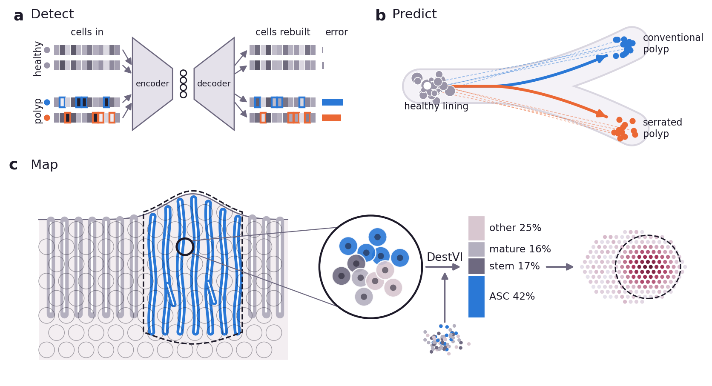
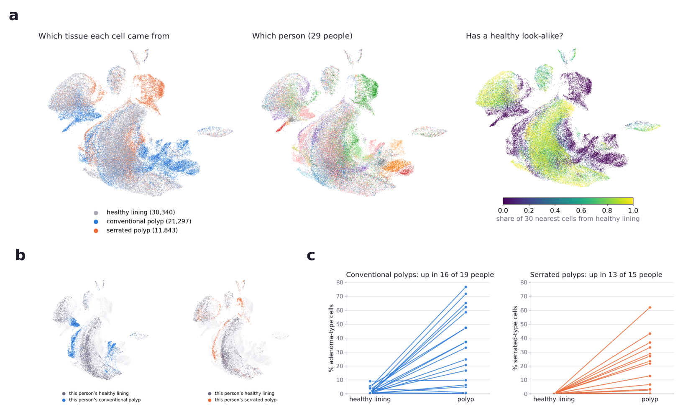
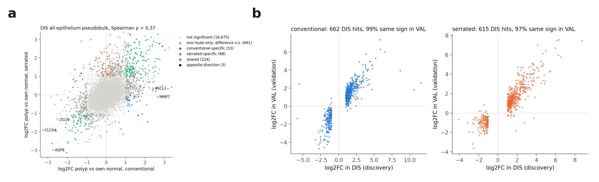
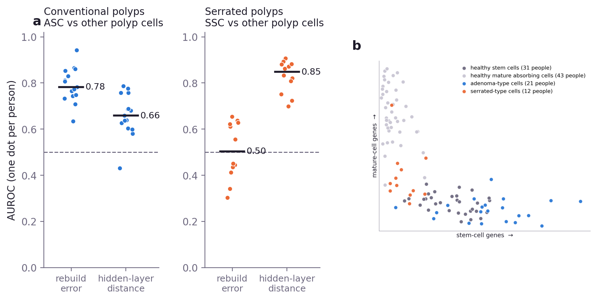
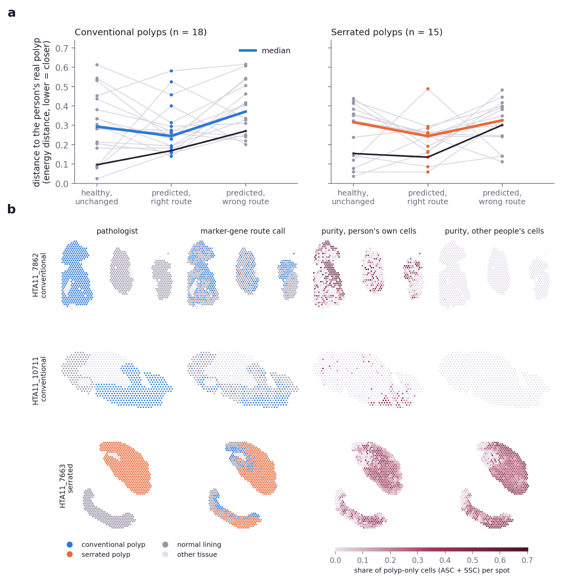

# Reading Each Polyp Against Its Own Healthy Lining: Detecting, Predicting and Mapping the Two Routes of Colorectal Precancer

Yuqi Lei, Muhammed Bah

<!-- Placeholders: [TBD: ...] = running experiment or figure still to be made. Word count is in the
     note below the references. -->

## Abstract

Colorectal cancer is the third most common cancer worldwide and the second leading cause of cancer
death, with about 1.9 million new cases and 900,000 deaths in 2022 (1). It grows out of two kinds
of polyp: conventional adenomas and serrated lesions.
Marker genes can label typical polyps of each kind, but they do not generalise to atypical polyps
and cannot describe how a polyp changes as it climbs the mutation ladder. In addition, current
single-cell atlases pool cells from many people and cannot report how one person's polyp differs in
gene expression. We therefore read every polyp against the same person's healthy lining and build
models to address these problems. First, a reconstruction model trained on healthy lining alone
picks out each route's new polyp cells using single-cell gene expression only. Next, we predict the polyp from healthy lining: a flow learned on other people
moves a new person's healthy cells toward their polyp along the correct route. Last, we map polyp
purity and route in tissue, where the person's own cells find adenoma cells that other people's
cells miss.

## 1. Introduction

Most colorectal cancers begin as polyps, and polyps follow one of two routes. Conventional
adenomas start with loss of APC, climb a well-known ladder of mutations (2), and give rise to most
colorectal cancers. Serrated lesions start with BRAF activation and widespread gene silencing
(3), and give rise to about a quarter of colorectal cancers (4). Because serrated
lesions are flat and pale, they are easier to miss at colonoscopy. Telling the two routes apart,
cell by cell and in the tissue itself, is therefore important for early detection.

Single-cell atlases of colon polyps have mapped both routes. Chen et al. (5) defined an
adenoma-specific cell (ASC) that grows from crypt stem cells ("bottom-up") and a serrated-specific
cell (SSC) that arises from mature cells through metaplasia ("top-down"). Becker et al. (6)
described a stem-like continuum from polyp to cancer, Heiser et al. (7) followed tumour evolution
in space, and Islam et al. (8) showed that some polyps start from several founder cells. Mutations accumulated along the
ladder turn a group of cells into one (2), and healthy crypts already carry cancer-gene
mutations, but are hard to detect (9), because they haven't transform and overgrow.

Also, most previous analyses rely on hand-picked marker genes from literatures. Markers label typical polyps
well, but they do not generalise to atypical ones, such as lesions with few of the expected new
cells or an adenoma that also carries the serrated programme. A fixed label also cannot describe
how a polyp changes as it climbs the mutation ladder, or indicate how will it evolve in the future. 

We therefore designed a model to address these problems (Fig. 1). It first trains a VAE on healthy lining to
find which polyp cells differ from the same person's healthy lining, using the gene expression
matrix only. It then learns how cells move along each route from the published polyp labels and
from healthy lining cells matched to polyp cells by unbalanced optimal transport (OT). Given a new
person's healthy cells, it predicts what their polyp would look like on each route and which genes
change along the way. Finally, we place single cells onto spatial tissue sample to measure how pure each spot is
and which route it follows.

## 2. Methods

**Data.** HTAN Vanderbilt epithelial single-cell objects (5): a discovery set (DIS; 65,088 cells,
62 specimens) and an independent validation set (VAL; 57,723 cells, 59 specimens), with the
authors' nine cell-state labels. 33 patients have both healthy lining and a polyp: 19 a conventional
polyp (tubular / tubulovillous adenoma) and 15 a serrated one (hyperplastic polyp / sessile serrated
lesion); one patient has both. Seven
Visium polyp sections come from six people, all with single-cell data (7). For a first look, all
cells are mapped by UMAP from 2,000 variable genes and 30 principal components, with no labels and
no batch correction.

**Step 1 — Detect.** We trained a variational autoencoder (12) on 33 person ×
route tests on other people's healthy cells only, as a
healthy reference (13), on the genes detected in ≥ 0.1 % of those cells (about 21,000). Each
held-out cell gets two scores: how badly it is reconstructed (negative-binomial deviance per count,
adjusted for sequencing depth within each person) and its mean distance to the 15 nearest healthy
training cells in the hidden layer; the two are combined by mean rank. Polyp cells are compared
with the person's own healthy cells (AUROC, AUPRC).

**Step 2 — Predict.** In 30 principal components, unbalanced optimal transport (14) pairs each
training person's healthy cells with their own polyp cells, and a flow-matching network (15) learns
the movement. A held-out person's healthy cells are moved by the flow and compared with their real
polyp (energy distance), against unchanged cells and the other route's flow.

**Step 3 — Map.** DestVI (16) splits each Visium spot into cell types with the person's own single
cells as reference. *Purity* is the per-spot share of polyp-only cells (ASC + SSC); a section's
*route* is the dominant one. Comparisons: an other-people reference and textbook marker genes (Wnt
targets; MUC5AC, TFF1, ANXA10). For ground truth setting, we use pathologist's annotations.

## 3. Preliminary Results

**Polyps can be mapped to their own lining.** On a map built from genes alone, polyp cells
stand apart from healthy lining, and each person's polyp sits next to their own lining (Fig. 2a,
b). Each polyp is closest to its own person's healthy lining in 21 of 36 cases (1.7 expected by chance). Pairing lowers the standard error of
gene effects by about 16 %.

**Each route adds its own new cell type.** ASC rises in 16 of 19 conventional polyps and SSC in
13 of 15 serrated polyps (Fig. 2c). In the median polyp they make up 24–48 % (ASC) and 17–22 %
(SSC) of the epithelium, while healthy lining has almost none.

**Shared and route-specific genes replicate.** In DIS, 224 genes change the same way in both routes
(up: MUC5AC, REG4; down: AQP8, CLCA4). There are 53 conventional-specific genes, led by Wnt targets
(ASCL2, NKD1, MMP7), and 68 serrated-specific genes (TFF1, TFF2, ANXA1) (Fig. 3a). In VAL, 99 %
(conventional) and 97 % (serrated) of DIS hits change in the same direction (Fig. 3b). Wnt
signalling is enriched only in conventional polyps (NES +1.96 DIS, +1.64 VAL), and TNF-α signalling
only in serrated polyps (+2.06, +1.83).

**A healthy-only model separates the routes by origin.** Without labels, the combined score
separates a new person's polyp cells from their own healthy cells with median AUROC 0.71
(conventional) and 0.67 (serrated), which means the two scores find different new cells. SSC cells lie far from healthy cells in
the hidden layer (AUROC 0.85 against other polyp cells) but are rebuilt almost as well as healthy
cells. ASC cells instead sit next to healthy stem cells, yet their genes cannot be rebuilt (AUROC
0.78; Fig. 4). Without using labels, the healthy model thus reproduces the two origins: expansion of an existing
stem state for adenomas, and a state absent from healthy lining for serrated lesions.

**Healthy lining points to the right route.** From a held-out person's healthy cells, the flow
lands closer to the real polyp than the unchanged cells in 23 of 33 tests, and in 20 of 21 polyps
with at least 10 % new cells. The right-route flow beats the wrong-route flow in 25 of 33 (Fig. 5a).
In the one person carrying both routes, each flow lands closer to its matching polyp (adenoma 0.17
vs 0.27; serrated 0.14 vs 0.30).

**Tissue maps recover route and purity.** Marker genes call the route of all 7 sections correctly.
With the person's own cells as the reference, DestVI calls 6 of 7, and 5 of 7 with other people's
cells. It finds ASC in two adenomas where the other-people reference finds none (share 0.19 vs
0.00; 0.08 vs 0.00). The share of polyp-only cells separates pathologist-drawn polyp from normal
spots with AUC 0.62–0.85 (Fig. 5b).

## 4. Preliminary Conclusion and Next Steps

Reading each polyp against the same person's healthy lining recovers the textbook two-route model
from data alone. Each route has its own new cell type and gene programme, and both replicate in an
independent cohort. A model of healthy lining separates the routes by origin without labels. A
person's healthy cells point toward the right route, and the person's own cells sharpen the polyp
map in tissue. Next we will:

1. **Detect:** finish the healthy-only model on all detected genes and report which genes it
   cannot rebuild in each person's polyp.
2. **Predict:** add the person's own healthy cell composition to the flow, and test whether it adds
   information beyond the average polyp of other people.
3. **Map:** turn spot purity into polyp borders and compare them with the pathologist's outline,
   including the lining next to the polyp.
4. **Landmarks:** use the open exome calls to tie each polyp's mutations to its route and purity.

## Figures

**Figure 1. Pipeline.** (a) Detect: a variational autoencoder trained on healthy lining only
rebuilds healthy cells almost unchanged but rebuilds polyp cells as healthy ones, so their genes
(outlined) come back wrong and the error is large. (b) Predict: unbalanced OT pairs each person's
healthy cells with their polyp cells, letting a cell's mass (dot size) grow or vanish; a flow then
learns the path from healthy lining to each kind of polyp. (c) Map: each Visium spot holds about
ten cells; DestVI splits it into cell types using the person's own single cells, and the share of
polyp-only cells (ASC + SSC) gives the spot's purity. Schematic, not data.

**Figure 2. The data at a glance.** (a) UMAP of DIS healthy-lining and polyp cells from genes
alone, coloured afterwards by tissue, by person, and by the share of each cell's 30 nearest neighbours that
come from healthy lining. (b) Two people highlighted: each polyp lies next to the same person's
healthy lining. (c) Share of ASC (conventional) and SSC (serrated) cells in healthy lining and
polyp; one line per person.

**Figure 3. Shared and route-specific gene changes.** (a) log2 fold change, polyp vs own lining, in
conventional (x) and serrated (y) polyps; colours mark shared and route-specific genes. (b) DIS
hits re-measured in VAL.

**Figure 4. A healthy-only model separates the routes by origin.** (a) How well each score picks
out the new cells among a person's polyp cells (AUROC; one dot per person, bar = median, dashed =
chance). The depth-adjusted rebuild error finds ASC; the hidden-layer distance finds SSC.
(b) Stem vs mature gene scores per person.

**Figure 5. Predicting and mapping the polyp.** (a) Distance from a held-out person's cells to
their real polyp: healthy cells unchanged, moved by the right route's flow, and moved by the wrong
route's flow. One line per person; thick line = median; black = HTA11_6801, the person with both
routes. (b) Three of the four Visium sections with normal spots (rows): pathologist annotation, marker-gene route call, and share
of polyp-only cells (ASC + SSC) per spot from DestVI with the person's own cells or other people's
cells as reference.

## References

<!-- Checked against Crossref metadata on 2026-10-25. -->

1. Bray F, et al. Global cancer statistics 2022: GLOBOCAN estimates of incidence and mortality
   worldwide for 36 cancers in 185 countries. *CA Cancer J Clin* 74, 229–263 (2024).
2. Fearon ER, Vogelstein B. A genetic model for colorectal tumorigenesis. *Cell* 61, 759–767 (1990).
3. Snover DC. Update on the serrated pathway to colorectal carcinoma. *Hum Pathol* 42, 1–10 (2011).
4. Crockett SD, Nagtegaal ID. Terminology, molecular features, epidemiology, and management of
   serrated colorectal neoplasia. *Gastroenterology* 157, 949–966.e4 (2019).
5. Chen B, et al. Differential pre-malignant programs and microenvironment chart distinct paths to
   malignancy in human colorectal polyps. *Cell* 184, 6262–6280.e26 (2021).
6. Becker WR, et al. Single-cell analyses define a continuum of cell state and composition changes
   in the malignant transformation of polyps to colorectal cancer. *Nat Genet* 54, 985–995 (2022).
7. Heiser CN, et al. Molecular cartography uncovers evolutionary and microenvironmental dynamics in
   sporadic colorectal tumors. *Cell* 186, 5620–5637.e16 (2023).
8. Islam M, et al. Temporal recording of mammalian development and precancer. *Nature* 634,
   1187–1195 (2024).
9. Lee-Six H, et al. The landscape of somatic mutation in normal colorectal epithelial cells.
   *Nature* 574, 532–537 (2019).
10. Muzellec B, et al. PyDESeq2: a python package for bulk RNA-seq differential expression analysis.
    *Bioinformatics* 39, btad547 (2023).
11. Squair JW, et al. Confronting false discoveries in single-cell differential expression.
    *Nat Commun* 12, 5692 (2021).
12. Lopez R, et al. Deep generative modeling for single-cell transcriptomics. *Nat Methods* 15,
    1053–1058 (2018).
13. Dann E, et al. Precise identification of cell states altered in disease using healthy
    single-cell references. *Nat Genet* 55, 1998–2008 (2023).
14. Chizat L, et al. Scaling algorithms for unbalanced optimal transport problems. *Math Comput* 87,
    2563–2609 (2018).
15. Lipman Y, et al. Flow matching for generative modeling. *ICLR* (2023).
16. Lopez R, et al. DestVI identifies continuums of cell types in spatial transcriptomics data.
    *Nat Biotechnol* 40, 1360–1369 (2022).
